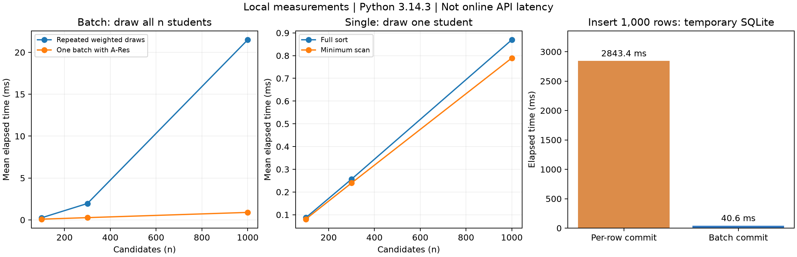

# 课堂随机点名系统 · 后端

Python + FastAPI + SQLAlchemy；本地使用 SQLite，在线使用 MySQL。
在线使用 TiDB Cloud Starter 的 MySQL 兼容模式，已配置 classroom_rollcall 数据库及 TLS，并通过云端完整流程验收，见 [验收记录](docs/cloud-validation.md)。连接配置保存在不提交 Git 的 .env 中。

## 本地启动

在本目录执行：

```powershell
python -m venv .venv
.\.venv\Scripts\python.exe -m pip install -r requirements.txt
if (-not (Test-Path .env)) { Copy-Item .env.example .env }
.\.venv\Scripts\python.exe scripts/init_db.py
.\.venv\Scripts\python.exe scripts/generate_teacher_key.py
.\start_backend.cmd
```

打开 [接口文档](http://127.0.0.1:8000/docs)，在 POST /api/students/import 上传 samples/sample_roster.xlsx。
默认配置生成 dev.db；关闭、重启服务不会清空数据库。
当前电脑已完成环境和云库配置，日常可直接双击 start_backend.cmd 启动；服务已启动时无需重复打开。
所有 `/api` 接口需要教师管理口令。打开本地 `.teacher-key.txt` 复制口令，在 `/docs` 右上角 Authorize 中填写；前端通过 `X-Teacher-Key` 请求头发送。口令文件已忽略，不上传 Git。

## 已实现

- Excel 表头匹配、按学号幂等导入、错误行定位及五列积分详单导出。
- 随机/按学号顺序点名，一轮不重复，点完自动进入下一轮。
- 到场、复述、回答记分及追加冲正记录的改判。
- 积分排名、随机点名次数、下一次点名概率、历史记录、个人积分变化曲线。
- 点名转移权；这是题目示例玩法，不能单凭此宣称原创创新。
- 抽签复核 API：保存的概率、随机键与原中签者可复算核对，供前端展示复核面板。
- 抽签保存候选权重、随机数和排序键，可核对算法执行结果；复算不能单独证明熵源未被操纵。

接口列表、调用顺序和图表字段见 [前端联调说明](docs/frontend-integration.md)。

## 核心规则

题目要求积分越高，被随机点到的概率越低；下列公式为项目自行设计，并非作业指定：

```text
p >= 0: w = (1+p)^(-alpha)
p <  0: w = (1-p)^alpha
P(i) = w_i / sum(w_j)       # 仅对下一次抽签的有效候选归一化
u_i ∈ (0,1)               # 实际抽签使用 secrets.SystemRandom
key_i = -ln(u_i) / w_i
winner = argmin(key_i)
```

默认 alpha=1，全积分范围权重严格递减；alpha=0 为显式等概率实验模式。
抽 1 人时扫描最小键为 O(n)，额外保存快照为 O(n) 空间；批量抽 k 人采用排序，为 O(n log n)。
HTTP 服务每次重新读取候选和最新积分，不能把“一次批量抽满全班”的复杂度当成连续 n 次 API 请求的复杂度。
同一轮末尾只剩 1 人时，其条件概率自然为 1；这是无放回规则带来的结果。

point_logs 由服务层只追加；students.total_points 与账本同事务更新。
写事务由 write_locks 中的一行数据库锁串行化，适用于当前单班场景，跨线程/进程生效。MySQL/TiDB 连接使用 READ COMMITTED（TiDB 使用悲观事务），避免等待锁后仍沿用旧快照；统一提交，失败回滚。
点名成功即增加次数；记分/改判不重复计数。转移目标增加总次数，随机中签次数仍归原中签者。

## 验证与性能

```powershell
.\.venv\Scripts\python.exe -m pytest -q
.\.venv\Scripts\python.exe scripts/benchmark.py --profile --output docs/benchmark.json
# 生成图表需要可选开发依赖：python -m pip install matplotlib
python scripts/plot_benchmark.py
```

本轮回归为 95 passed（本机 Python 3.14.3、临时 SQLite），包含实际并发、过期状态、教师口令、导入边界、精度受限记录与抽签复核；云端流程另见验收报告。
有一条已安装 Starlette/httpx 组合的弃用提示，未影响测试通过。

本次实测的完整数据在 [JSON](docs/benchmark.json) 和 [热点报告](docs/benchmark.txt) 中。
固定种子仅用于测试/基准；实际点名使用系统随机源。SQLite 批量写入测试是事务策略对照，不是云端 Excel API 耗时。
部署可使用 `pip install -r requirements.txt -c constraints-tested.txt` 安装已验证版本约束。部署蓝图在 deploy/render.yaml，适用于总仓库的 backend/ 子目录；需要配置 DATABASE_URL、TEACHER_API_KEY、CORS_ORIGINS，DB_SSL 已设为 1。
快照三列使用 DOUBLE。当前云库已完成精度升级；其他旧 MySQL/TiDB 库可在停服期间运行 scripts/upgrade_snapshot_precision.py。旧 FLOAT 记录已经损失的精度无法补回，复核可能返回 precision_limited，不显示为精确验证通过。



## 后续交付

- [在线数据库、Educoder 与部署步骤](docs/setup-next.md)
- [博客第三部分草稿及设计图](docs/blog-implementation.md)

云数据库已接通；Educoder 远程仓库和后端公网部署尚未完成。当前 API 运行在本机，连接在线数据库。
sql/schema.sql 是包含 5 条样例数据的重建脚本，开头会 DROP TABLE；日常初始化使用 scripts/init_db.py，已有表结构变更需要另做迁移。

## 代码结构

```text
app/api/         HTTP 参数收发与响应校验
app/services/    导入、点名、积分、统计及事务
app/core/        权重与抽样纯算法
app/models.py    六张业务表及一张事务锁表
app/schemas.py   请求与响应类型
scripts/         数据库检查、样例、性能实验
tests/           算法、Excel、API 回归
docs/            联调、交付与博客素材
```
