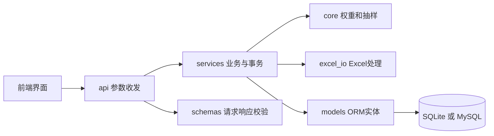
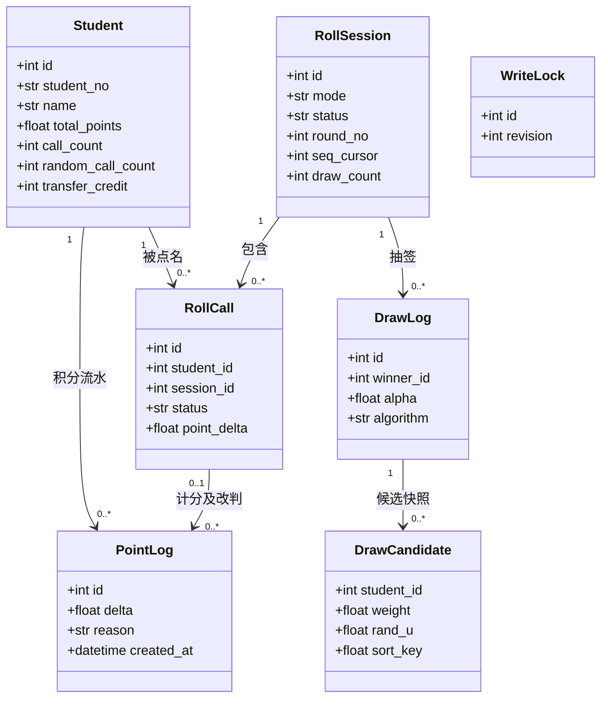
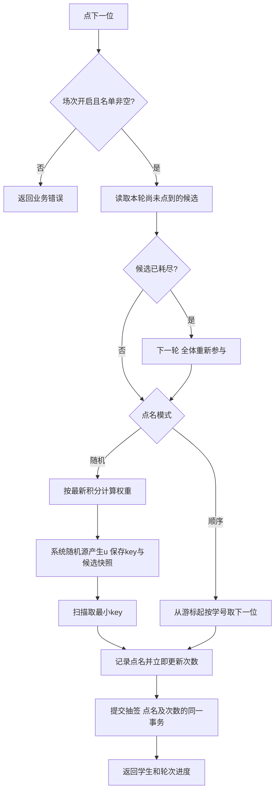
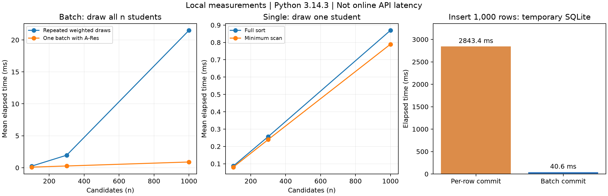

# 三、编程实现

本文为后端部分的技术草稿，依据当前代码和本机实测整理。上线、协作经历、commit 截图尚未发生，不应写成已完成。
与完整博客合并时保留附件规定的一级、二级标题；正文前 3 行分别补真实 Educoder 仓库、博客和视频链接。

## 3.1 开发工具库（如文件读取包等）的使用

| 工具/库 | 用途 |
| --- | --- |
| Python、FastAPI、Pydantic | 路由、参数校验、响应结构及交互式接口文档 |
| SQLAlchemy、PyMySQL | ORM 与事务；本地 SQLite，在线 MySQL 驱动 |
| openpyxl、python-multipart | Excel 工作簿处理及上传 |
| secrets、math | 系统随机源、权重、指数竞赛排序键 |
| pytest、httpx/TestClient | 纯算法与 HTTP 集成测试 |
| cProfile、matplotlib（可选开发依赖） | 函数热点分析及实测图绘制 |
| zoneinfo、tzdata | 北京时间生成及 Windows 时区支持 |

环境变量由 app/config.py 读取，真实密码只放在本地 .env 或部署平台环境变量。

## 3.2 代码组织与内部实现设计（类图）

图 1：代码分层。路由不直接实现抽样，服务层控制积分和抽签事务，核心算法可以独立测试。



图 2：核心实体类图。DrawLog.winner_id、DrawCandidate.student_id 是快照标识，当前没有到 Student 的数据库外键，不应画成强制外键关系。



六张表保存名单、场次、点名、积分流水和抽签过程。学号唯一，点名记录有 (session_id, round_no, student_id) 唯一约束。
另外增加 write_locks 技术表，以 id=1 的锁行保护单班写事务。事务入口先结束路由的只读快照，获取写锁后刷新状态，防止交错请求重复记分或丢失学生汇总更新；正常提交、异常回滚。所有业务写入都经过这一层，不使用仅在单进程有效的线程锁。
TiDB 云端实测进一步发现 RR 快照在等待锁后仍可能读到旧状态，因此连接显式采用 READ COMMITTED，并核对实例为 pessimistic 事务。这个问题在 SQLite 并发测试中没有暴露，说明真实数据库验收仍不可省略。[官方隔离级别说明](https://docs.pingcap.com/tidb/stable/transaction-isolation-levels/)
积分汇总缓存用于排行榜；记分与流水同一事务提交。只追加由服务层实现，当前不代表数据库账号被禁止执行 UPDATE/DELETE。

## 3.3 说明算法的关键与关键实现部分流程图

权重为自主设计：非负积分 p 使用 (1+p)^(-α)，负积分使用 (1-p)^α。默认 α=1，在所有积分范围连续且严格递减，避免负分钳到零分后概率相同。
α=0 为等概率实验模式；积分抑制要求用默认正 α 演示。
对每名有效候选产生独立随机数 u，计算 key=-ln(u)/w，取最小者；等价于按权重的指数竞赛，单次中签概率为 w/sum(w)。
同一轮过滤已点学生；全部点完再开启下一轮。积分在下一次点名时重新读取，因此刚完成记分会影响后续抽签。

图 3：点名关键流程。概率盘复用 next_candidates，只读预览，不提前写入新轮次。



快照复算能够核对结果与记录是否一致，但不是独立的密码学公平性证明，也不能保证快照从未被有权限者修改。

## 3.4 贴出重要的/有价值的代码片段并解释

核心权重实现位于 app/core/weights.py：

```python
points, alpha = float(points), float(alpha)
if not math.isfinite(points) or not math.isfinite(alpha) or alpha < 0:
    raise ValueError("积分和 alpha 必须是有限数值，alpha 不能为负数")
return math.pow(1.0 + abs(points), alpha if points < 0 else -alpha)
```

例如 -1、0、1 分权重分别为 2、1、0.5。概率针对同一有效候选集合归一化；本轮已点者不参加，顺序模式也不使用随机概率。

改判核心位于 app/services/points.py：

```python
old_delta = float(rollcall.point_delta)
new_delta = round(sum(item[1] for item in parts), 1)
diff = round(new_delta - old_delta, 1)
student.total_points = round(float(student.total_points) + diff, 1)
```

后续追加 reason=manual 的 PointLog，并更新点名当前得分。比如 3.5 分改成 0 分，追加 -3.5 的流水；个人曲线按账本 id 顺序累加保留过程。
到场、复述和回答分值分别计算；导入以学号更新基本信息，不覆盖积分缓存。

## 3.5 性能分析与改进

本次实验为 Windows 11、Python 3.14.3 本机结果；原始文件见 benchmark.json、benchmark.txt，图表由 plot_benchmark.py 根据 JSON 生成。
算法用固定种子和内存候选，数据库写入用临时 SQLite。不能据此宣称云端 MySQL 或整个 HTTP 接口达到相同耗时。



| 实验 | 对照组 | 改进组 | 说明 |
| --- | ---: | ---: | --- |
| 1000 人一次抽满全班 | 21.495 ms | 0.897 ms | 重复累计权重抽样 vs A-Res 批量排序，重复 5 次取平均 |
| 1000 人中抽 1 人 | 0.870 ms | 0.790 ms | 同样构建随机键与快照，完整排序 vs 扫描最小值，重复 100 次取平均 |
| 写入 1000 名学生 | 2843.4 ms | 40.6 ms | 每行提交 vs 一次批量提交；单次实验 |

当前 HTTP 路径每次只抽 1 人，将候选排序改成 min 扫描，选择阶段从 O(n log n) 降为 O(n)。完整快照仍为 O(n) 空间和写入量。
cProfile 的累计热点是 sample_without_replacement，自身耗时及 Candidate 构建占主要部分。该分析未覆盖线上网络、MySQL 写入或接口全路径。
连续抽完整轮仍会重复计算候选，快照总量约 n(n+1)/2，为 O(n²)，不能把一次批量抽样的 O(n log n) 直接套在整个课堂场次上。
后续可实测 MySQL 往返、快照批量写入与并发事务开销；这些优化目前没有完成，不填虚构数据。

## 3.6 单元测试

本轮回归：95 passed，1 条 Starlette/httpx 弃用提示，约 4.35 秒。命令为 .venv/Scripts/python.exe -m pytest -q。
用临时 SQLite 隔离真实数据。另已针对 TiDB Cloud Starter 执行真实 HTTP 流程验收，覆盖建表、导入、点名、记分/改判、统计、导出及独立连接读取持久化数据，记录见 cloud-validation.md；不能据此声称全部单元用例均已在 TiDB 上运行。

| 场景 | 数据构造与预期 |
| --- | --- |
| 负分概率 | -100 到 9 分的候选，权重有限、为正并严格递减 |
| 抽样分布 | 固定种子下抽 20000 次，与理论概率做 4σ 比较 |
| 一轮不重复 | API 抽满 5 人不重不漏，第 6 次进入第 2 轮 |
| 轮次预览 | 点满后连续查询两次概率，不修改真实轮次；下一抽才换轮 |
| 顺序模式转移 | 转给下一个学号，之后跳过该学生，下一轮仍从正确游标继续 |
| 点名次数 | 抽签即增次，记分/改判不再增加；转移目标不冒充随机中签 |
| 排行口径 | 混合顺序与随机点名，图表次数等于 random_call_count |
| 个人积分曲线 | 0→1→1.5→3.5，改判追加 -3.5 后回到 0，旧流水不变 |
| Excel | 表头别名、错误行、重复导入保分、五列导出 |

修复原有概率测试时，不再断言“名单第一人一定为 0.25”，而是依据实际抽中的 student_id 判断该人为 0、其余人为 0.25。实际随机源不因测试需要而固定。
新增 ThreadPoolExecutor + Barrier 并发回归：两个记分请求只有一个成功；不同点名对同一学生记分时积分不丢失；8 个同时点名请求的学生和序号均不重复；同时开课只保留一个开启场次。另验证过期改判、记分与转移竞争、缺席问答拒绝、原始分数下限、超长字段行号、教师口令及抽签复核异常记录。

教师管理口令由 secrets 生成，通过 X-Teacher-Key 请求头传输并恒定时间比较；所有业务 API 受保护。新增抽签复核接口展示历史权重和随机键，仅核对保存记录的一致性，不将它表述为不可篡改或独立公平性证明。
云端复核发现 ORM 的 FLOAT 只保留单精度，导致随机键约 1e-7 的误差。已将 weight、rand_u、sort_key 升级为 DOUBLE；旧历史记录的精度无法恢复，接口使用 precision_limited 与 verified=null 区分近似复算，避免对旧记录作虚假的精确验证声明。

## 3.7 贴出代码commit记录

待用户创建 Educoder 仓库并真实提交后补充。当前不提供模拟提交截图或伪造历史。
建议贴真实 git log --oneline --date=short 输出和平台提交页截图，覆盖实现、修复、联调、部署等实际阶段；已完成工作的首个提交如实记录为一次初始导入。
